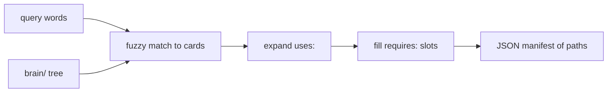

<div align="center">

# `tagen`

**A CLI that turns a `brain/` directory of typed markdown cards into a JSON manifest of the files an agent should load for one task.**

[](https://www.npmjs.com/package/@questi0nm4rk/tagen)
[](https://github.com/Questi0nM4rk/tagen/actions/workflows/ci.yml)
[](./LICENSE)
[](https://github.com/Questi0nM4rk/tagen/releases)

</div>

```text
examples/brain/
├── lang/csharp/CORE.md      aliases: [dotnet]
├── lang/python/CORE.md
└── review/strict/CORE.md    requires: [lang]
```

```console
$ tagen get strict csharp --root examples --json
{
  "modules": [
    { "type": "lang",   "name": "csharp", "core": "brain/lang/csharp/CORE.md" },
    { "type": "review", "name": "strict", "core": "brain/review/strict/CORE.md" }
  ],
  "warnings": []
}
```

(Trimmed. The real manifest has more fields, see [the schema](docs/tagen-get-manifest.schema.json).)

## Why it exists

Agents that write code or review pull requests need a different slice of guidance for each task.
The options I saw were hard-coded file paths that break on every rename, loading the whole catalog every time, or describing the needed guidance in prose on each run.
tagen makes the choice declarative: a card says `requires: [lang]`, and the query picks which language card fills the slot.
It refuses to be a build system, a tag system or a writer of your content. It has no reason to exist if the agent harness can compose and load context like this natively.

## Quickstart

Tested with Bun 1.3.14.

```bash
bun install
bun src/main.ts get strict csharp --root examples
bun test
```

Expected output of the second command:

```text
2 card(s), 1 slot(s), 0 warning(s).
Use --json for the full manifest.
```

Add `--json` for the manifest. Other commands: `list`, `search`, `validate`, `add`. See
[docs/guide.md](docs/guide.md).

From npm instead of a clone: `bun add -g @questi0nm4rk/tagen`. Then run `tagen` in any directory
that has a `brain/` directory above it.

## How it works



tagen reads the directory tree. The tree is the vocabulary: type is the parent directory, name
is the card directory. It matches your words to cards, fills each `requires:` slot with the
first candidate in alphabetical order (or the one you `--pin`), and prints paths. The agent
loads the files.

Everything is deterministic. No model is called, no network is used, and `get`, `list`,
`search` and `validate` never write. Only `add` writes a card.

## Numbers

Measured 2026-10-12 on Arch Linux, Bun 1.3.14.

| What | Value | How measured |
| --- | --- | --- |
| Tests | 213 pass, 0 fail | `bun test` |
| Test time | about 7 s (6.98 to 7.30 over two runs) | `bun test` |
| Source size | 2,664 code lines in 37 TypeScript files | `scc src` |
| One `get` on the example brain | 0.17 s wall (median of 5 runs, 0.15 to 0.25) | `time bun src/main.ts get strict csharp --root examples` |

Commits include agent-authored work under my identity; design, orchestration and review are mine.

## Status

- **Works:** `list`, `search`, `validate`, `get`, `add`. CI runs typecheck, lint and tests on every push.
- **Experimental:** the manifest shape may change between major versions.
- **Tried and dropped:**
  `build`, `diff`, `resolve`, `sync`, `demo` and `tags` commands, and the `vocabulary.yaml` and `capabilities.yaml` files. The directory tree
  replaced them (v2). The vendor model field on cards was removed to keep cards
  harness-neutral (v3).
- **Known gaps:** slot filling picks the alphabetically first card unless pinned. There is no transitive resolution of `requires:` or `uses:`. I have used tagen only with my own
  card catalog, so the card format is untested on others.

Release notes are in [CHANGELOG.md](CHANGELOG.md).

## License

GPL-3.0.

Releases published before 2026-10-12 remain available under MIT.
